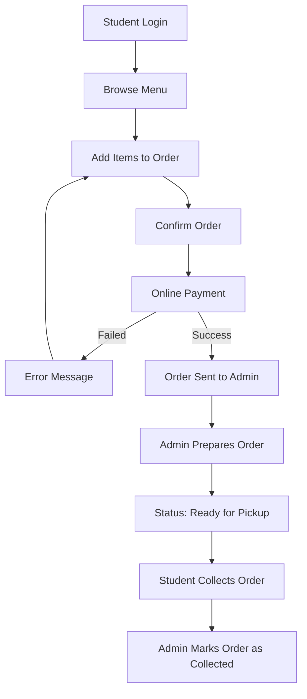

# CampusBite

## Slide 2: System Features

CampusBite has two types of users: **students**, who order food, and the **admin** (cafeteria staff), who manages the menu and the orders.

### Student Functionalities

- Register and log in to the system
- Browse the cafeteria menu by category
- Add food items to the cart and place an order
- Pay online and receive a receipt
- Track the order status
- View previous orders

### Admin Functionalities

- Log in as admin
- Add, update, and delete food items
- Manage the menu and the availability of items
- View the incoming orders
- Update the order status (Preparing, Ready, Collected)
- View payment records and sales reports

### Online Payment Process

1. The student confirms the order and the total price.
2. The student chooses a payment method.
3. The system checks the payment.
4. If the payment succeeds, the order is confirmed and a receipt is created.
5. If the payment fails, an error message is shown and the order is not placed.

### Order Pickup Process

1. The order is placed and paid.
2. The admin prepares the order.
3. The status changes to "Ready for Pickup".
4. The student receives an order number and collects the order from the pickup location.
5. The admin marks the order as "Collected".

### System Workflow Diagram

